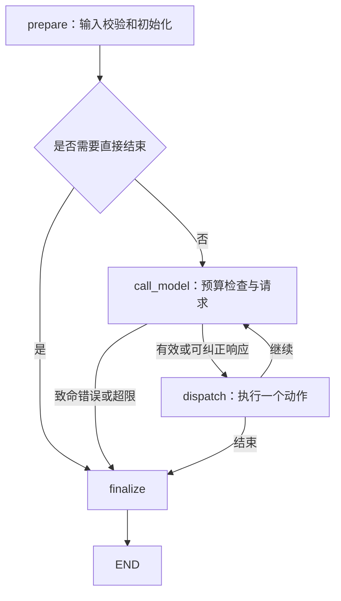

# 方案与技术取舍

当前已实现六动作单 Agent、LangGraph 状态图、DeepSeek 适配、Mock、CLI、Trace 和输出文件。业务理解基线仍为 v0.1.0；早期五动作建议已被用户确认的六动作协议替代。

本轮更新 SYSTEM_PROMPT，明确授权与主题相关事实、按字段的 allowed_expressions、同镜引用、至少一条事实、工具错误区别、补充与未完成的选择、当前稿重检及预算。不改变工具或执行器的完成条件。main 为每次运行保存 system_prompt_sha256；批量验证仅观察真实 Trace，不控制模型下一步或替换工具结果，见 [新提示词验证](../examples/prompt-validation/README.md)。

## 分层职责

| 模块 | 实际职责 |
| --- | --- |
| `main.py` | 文件/终端 JSON 输入、配置与资料加载、结果保存、终端展示和退出码。 |
| `schemas.py` | 不可变输入、素材、脚本、检查报告、任务状态及完成条件。 |
| `model.py` | 配置、六个函数声明、响应解析、HTTP 错误和状态驱动的离线 Mock。 |
| `agent.py` | LangGraph 节点、动作校验、可信状态、版本历史、检查、预算和终态。 |
| `tools.py` | 真实本地检索、估时、受限事实及品牌规则检查。 |
| `trace.py` | 实际事件 JSONL、简短依据及凭据/内部推理字段过滤。 |
| `profiles.py` | 清单、总表、产品/客户端、来源与必需规则校验；应用审阅排除，提供默认输入。 |

## 框架与模型

已安装 LangGraph 1.2.18、python-dotenv 1.2.4，全部环境版本见 `requirements.lock.txt`。LangGraph 仅负责 StateGraph、节点、状态更新、条件边和调用；没有使用预制多 Agent、托管服务、持久化会话或 LangSmith 业务功能，无须重新实现框架。

DeepSeek 通过标准 Chat Completions HTTP 协议调用，模型为 `deepseek-v4-pro`。显式关闭 thinking；不展示或持久化内部推理。模型收到需求、品牌规则、允许表达、当前状态、工具声明及原生消息历史。事实原文通过真实检索进入上下文，不预先把完整资料库当作已检索事实。

配置由进程环境覆盖本地 `.env`。默认只让 DeepSeek 直连，保留可选继承系统代理的开关，不修改全局代理。API 密钥不进入提示词、状态输出或元数据；响应错误不直接展示服务端原始正文。

## LangGraph 节点

业务动作由模型选择，节点不预排“检索一次、生成一次、检查一次”。模型可改写查询、重存草稿、选择两类检查的顺序、请求补充或申请结束。图步数上限只是后备保护，主要预算由程序主动检查。

## 六个动作

- `search_materials(query, material_ids?, reason)`：范围只能在允许 ID 内选择，实际结果累积到已检索资料。
- `save_script(title, shots, reason)`：完整草稿由程序校验和分配新版本/指纹，新稿无可用检查；旧版记录保留。
- `estimate_duration(script_version, reason)`：仅当前版本；目标上限从 TaskInput 注入。
- `check_rules(script_version, reason)`：仅当前版本；注入可信且已检索的素材和固定品牌规则。
- `request_input(missing_fields, questions, reason)`：以 needs_input 结束，首版不恢复会话。
- `finish(status, reason)`：申请 completed 或 incomplete，程序核对后生成 TaskResult。

动作 JSON Schema 和 description 已在 `model.py` 注册；Python 数据类型与模型参数 Schema 是两个层次。首版每轮一个原生函数调用。批量调用全部拒绝，并给每个调用 ID 对应错误结果；没有执行一半或伪造调用。

## 状态与完成条件

运行状态保存用户需求、消息、只读资料范围、已检索资料、每版 Script、各版检查、步骤/工具计数、最近观察、历史错误与未解决错误。消息追加、版本字典覆盖更新；模型不能重写资料、规则、版本、指纹或报告。

保存 v3 后，v2 的检查仍在历史中，当前视图只展示 v3 的检查。对同稿重新检查失败也会撤销此前该项通过结果，不能继续沿用。只有最终稿具备同版本同指纹的两类通过报告、有效已检索引用、适用规则覆盖和原始时长上限，才可完成。历史错误保留，但已恢复的工具错误不会永久阻断交付。

工具检查之外，增加了“引用了素材却没有实际表达任何所引事实”的阻断项，避免空引用让纯衔接文案冒充有依据的产品脚本。检查仍不是开放域语义判断，边界见 [工具说明](07-tools.md)。

## 预算与错误

默认 12 次模型请求、8 次业务工具执行尝试、60 秒单次超时、1 次连续临时传输错误重试。每次真实请求（包括重试、非法响应纠正和被拒绝的结束申请）都计数；工具失败也计调用次数。无效动作不执行工具，但不退还本轮步骤。

空资料、工具失败、规则不通过和过期版本反馈模型。配置/认证或持续传输错误以 failed 结束；预算不足且尚未终结则 incomplete，保留已有草稿。GraphRecursionError 后备路径保留最近节点状态。

## 输出、验证与演进

保存 result、script、checks、history、trace 和 run 元数据；后者包含模型、运行模式、故障注入、预算、资料和代码指纹。目录默认按 run_id 新建，不覆盖既有结果。

旧提示词的真实正常任务与故障注入任务已出现改写检索、修订稿件和重新检查。新提示词的五条 Mock 路径通过，真实尝试连接失败；详见 [评估](03-evaluation.md)。Mock 调用同一执行器和真实工具，只证明流程，不能证明真实模型效果。

后续前端经 HTTP API 复用同一业务核心；会话恢复、自由表达事实判断和真实时长测量尚未实现。

## 产品配置接入

从本地 profile 注入 data_scope 和 retrieved_material_metadata，事实和来源仅在实际检索后交给模型。每次选择单产品/客户端范围，全部适用规则完整加载；拒绝手动素材/规则覆盖。使用独立配置避免直接混合 40 条总表，P_CAN_010 暂缓，原包保持不改。来源导出 sources.json 并展示于 Markdown，配置、来源和审阅文件摘要写入 run.json，详见 [资料接入](09-data-pack.md)。事实检查工具没有放宽，Mock 仅按当前配置选择事实，不证明真实模型的相关性判断。
